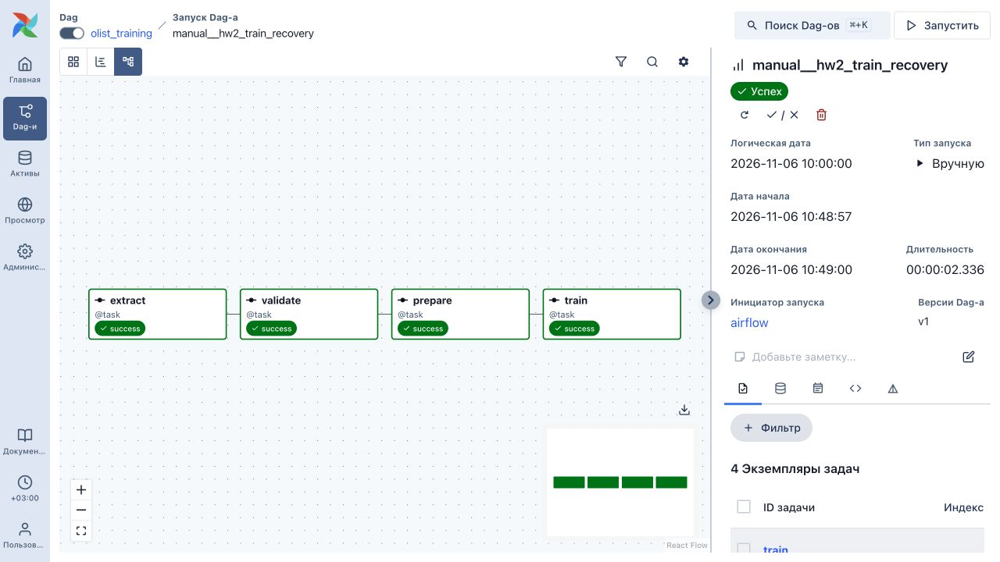
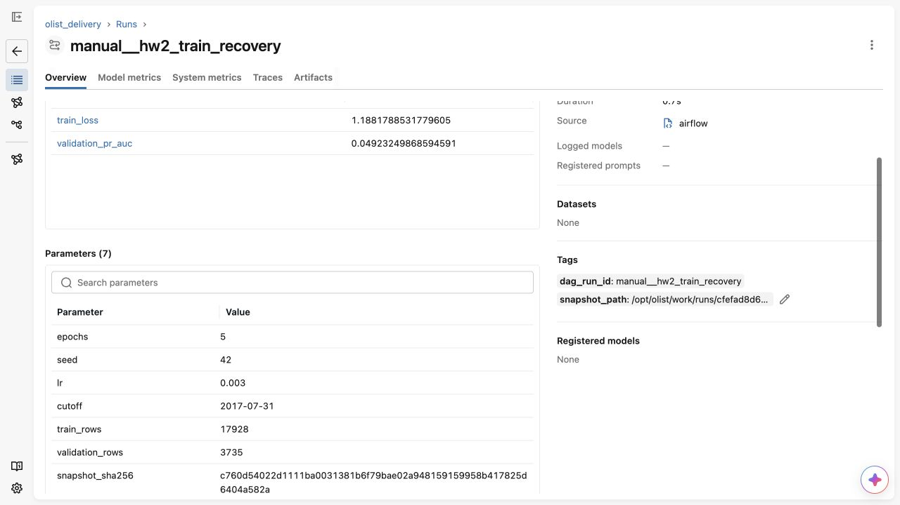

# ДЗ 2. Локальный ML-пайплайн Olist

Автор: **Габидулин Андрей**.

`PostgreSQL → extract → validate → prepare → train → MLflow`. Обучается выданная CPU-модель. Данные, `src/olist_model.py` и `src/check_model.py` сохранены без изменений.

## Запуск

Нужны Git, Docker с Linux engine и Docker Compose v2. Рекомендуется выделить Docker 4 CPU, 6 ГБ RAM и 15 ГБ диска. Обучение на CPU; Kaggle, удалённый сервер и внешняя БД не требуются.

```bash
git clone "$REPOSITORY_URL" olist-homework
cd olist-homework
cp .env.example .env
docker compose up -d --build
docker compose ps
```

`REPOSITORY_URL` — адрес репозитория с этим решением. Если проверяете архив, распакуйте его и выполняйте команды начиная с `cd olist-homework`.

| Интерфейс | Адрес на компьютере |
|---|---|
| Airflow | http://127.0.0.1:8080 |
| MLflow | http://127.0.0.1:5050 |

Интерфейсы открыты только на `127.0.0.1`. Внутри Docker Airflow обращается к `source:5432` и `http://mlflow:5000`. Порты и параметры меняются в `.env`; после изменения пересоздайте сервисы. MLflow использует именованный volume `mlflow-data` для SQLite и артефактов; Airflow, исходная БД и рабочие файлы также имеют отдельные постоянные volumes.

В Airflow включите и запустите `example_one_task`, затем `olist_training`. Для запуска из терминала:

```bash
docker compose exec -T airflow airflow dags unpause example_one_task
docker compose exec -T airflow airflow dags trigger example_one_task
docker compose exec -T airflow airflow dags unpause olist_training
docker compose exec -T airflow airflow dags trigger --run-id manual__check_1 olist_training
```

DAG запускается еженедельно; `catchup=False`, `max_active_runs=1`. У чтения БД 2 повтора с паузой 30 секунд. У валидации повторов нет. Все четыре задачи имеют timeout, зависимые задачи используют `all_success`.

## Данные и воспроизводимость

В БД 21 663 заказа. `extract` читает их в фиксированном порядке и атомарно заменяет UTF-8 CSV в `/opt/olist/work/runs/<SHA256 Airflow run_id>/snapshot.csv`. Повторный запуск не добавляет строки; разные DAG run используют разные каталоги.

`validate(snapshot)` только читает файл. Проверяются 13 обязательных столбцов, непустые данные, уникальные непустые ID, даты, конечные числовые признаки и бинарная метка. Подготовка использует выданный `split_by_time`: train до `2017-07-31`, validation начиная с этой даты; 17 928 и 3735 строк. Преобразования обучаются только на train внутри выданной модели.

XCom содержит только абсолютные пути, размеры, cutoff и SHA256 **байтов исходного CSV**, а `train` возвращает MLflow run ID. В MLflow сохраняются параметры, метрики каждой эпохи, точный тег `dag_run_id`, путь исходного снимка и `data/snapshot.json`. Артефакт `model/` содержит `weights.pt` и `preprocessing.json`; проверяется совпадение прогнозов после восстановления.

Параметры по умолчанию: `OLIST_EPOCHS=5`, `OLIST_SEED=42`, `OLIST_LR=0.003`, `OLIST_CUTOFF=2017-07-31`. Эксперимент — `MLFLOW_EXPERIMENT_NAME=olist_delivery`. Метрика `validation_pr_auc` — average precision; выход модели не является калиброванным риском.

## Проверка модели и постоянного хранения

В новом окружении возьмите MLflow run ID из результата задачи `train` или интерфейса MLflow:

```bash
docker compose exec -T airflow python -m check_model --run-id RUN_ID
docker compose restart
docker compose up -d --force-recreate --no-deps mlflow
# После healthy повторите ту же команду с прежним RUN_ID.
docker compose exec -T airflow python -m check_model --run-id RUN_ID
```

Не удаляйте volumes при проверке сохранности. Контроль числа строк:

```bash
docker compose exec -T source psql -U olist -d olist -c 'SELECT count(*), count(DISTINCT order_id) FROM orders;'
docker compose exec -T airflow python -c "import urllib.request; print(urllib.request.urlopen('http://mlflow:5000/health').status)"
docker compose exec -T airflow python -m unittest discover -s /opt/olist/tests -v
```

## Проверки выполненного решения

Проверено 06.11.2026 в Linux ARM64 Docker-окружении на Apple M3 Pro. Все сервисы `healthy`; 5 автоматических проверок пройдены.

| Проверка | Результат |
|---|---|
| `example_one_task` | Успех |
| `manual__hw2_success_1`, `manual__hw2_success_2` | Все 4 задачи успешны; разные MLflow run |
| Повторное чтение | В каждом снимке 21 663 уникальных заказа, одинаковый SHA256; строки не накапливаются |
| `manual__hw2_bad_snapshot` | Дубликат в отдельной копии; `validate=failed`, `prepare/train=upstream_failed` |
| `manual__hw2_train_recovery` | После исправления кода Clear через UI только для `train`: успех на попытке 2; остальные задачи остались на попытке 1 с прежними start/end |
| Restart + force-recreate MLflow | Все 3 проверенные модели, параметры, метрики 5 эпох и прогнозы сохранились без изменений |

При проверке отказов временно переопределялись функции в `olist_pipeline.py`. После проверки исходное решение восстановлено. Clear выполнялся в интерфейсе: открыть задачу `train` нужного запуска → Clear → убедиться, что затронута одна задача; не выбирать upstream/downstream → подтвердить.

MLflow run первого ручного запуска: `a09e7a0b8164437daf876f6dc1f87f7a`; второго: `9a37e34b513c42589b85895d5e79a651`. Итоговые метрики первого запуска: `train_loss=1.1881788532`, `validation_pr_auc=0.0492324987`. Улучшение модели в этом задании не требовалось.

Точная выполненная команда загрузки модели:

```bash
docker compose exec -T airflow python -m check_model --run-id a09e7a0b8164437daf876f6dc1f87f7a
```

Пять прогнозов до и после перезапуска:

```json
[0.7106074094772339, 0.5012513399124146, 0.2709561884403229, 0.1435118466615677, 0.22757172584533691]
```

В чистом окружении создайте новый run и подставьте его ID. Старые run ID относятся к локальным volumes проведённой проверки.

Исходный SHA256 CSV: `c760d54022d1111ba0031381b6f79bae02a948159159958b417825d6404a582a`. В MLflow путь снимка находится в теге `snapshot_path`, а пути и hash — в артефакте `data/snapshot.json`.

Оба скриншота ниже показывают `manual__hw2_train_recovery` после Clear. Его MLflow run: `3e8cc315459c469facf3be14a0100fb0`.

### Успешный DAG



### MLflow: параметры и метрики



Источник и лицензия данных: [data/README.md](data/README.md), [data/LICENSE.md](data/LICENSE.md). Полное условие: [ASSIGNMENT.md](ASSIGNMENT.md).
